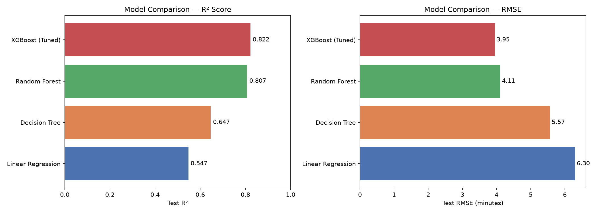
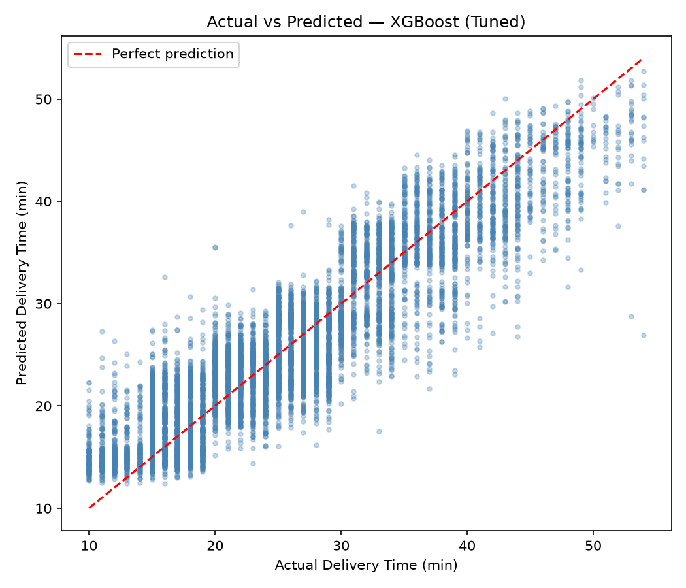

# Delivery ETA Predictor 🚀

> **Predicts end-to-end food delivery time (in minutes)** using order, weather, traffic, geographic, and temporal features — designed with production-grade leakage prevention, coordinate validation, and unified scikit-learn/XGBoost pipelines.

---

## 📋 Table of Contents

- [Problem Statement](#-problem-statement)
- [Project Architecture](#-project-architecture)
- [Dataset & Data Quality](#-dataset--data-quality)
- [Prediction Moment & Prep Time Analysis](#-prediction-moment--prep-time-analysis)
- [Methodology & Leakage Prevention](#-methodology--leakage-prevention)
- [Benchmark Results](#-benchmark-results)
- [Key Insights](#-key-insights)
- [How to Run](#-how-to-run)
- [Tech Stack](#-tech-stack)
- [Attribution](#-attribution)

---

## 🎯 Problem Statement

On-demand delivery platforms (e.g. Swiggy, Zomato, DoorDash) depend on accurate Estimated Time of Arrival (ETA) predictions to:
- Provide transparent delivery expectations at checkout to maintain customer trust.
- Optimize delivery partner dispatch timing to minimize rider wait time at restaurants.
- Dynamic route planning and batch dispatching.

This project frames ETA prediction as a **supervised regression task**: given the multidimensional features of an order, predict the continuous target `Time_taken(min)` from order placement to doorstep handover.

---

## 📁 Project Architecture

The repository enforces a strict, modular structure where both the standalone CLI pipeline and the exploratory Jupyter Notebook share the identical preprocessing, encoding, and training codebase from `src/`:

```
delivery-eta-predictor/
│
├── data/
│   └── delivery_data.csv          ← Raw dataset (45,593 records × 20 columns)
│
├── notebooks/
│   └── Food_Delivery_ETA.ipynb    ← Interactive EDA & modeling notebook (runs unified src/ pipeline)
│
├── src/
│   ├── __init__.py
│   ├── data_preprocessing.py      ← Stateless cleaning, GPS validation & coordinate correction
│   ├── feature_engineering.py     ← Leakage-free DeliveryPreprocessor (fit on train only)
│   └── model_training.py          ← Multi-model evaluation, RandomizedSearchCV & Joblib export
│
├── models/
│   └── xgb_model.pkl              ← Unified Joblib bundle (model + preprocessor + scaler + feature metadata)
│
├── outputs/
│   ├── model_comparison.png       ← Benchmark charts across R², RMSE, and MAE
│   └── actual_vs_predicted.png    ← Parity plot: ground truth vs tuned XGBoost predictions
│
├── main.py                        ← End-to-end production pipeline runner (CLI)
├── requirements.txt               ← Project dependencies with minimum versions (joblib, xgboost, scikit-learn, etc.)
├── .gitignore
└── README.md
```

---

## 📊 Dataset & Data Quality

| Property | Value |
|----------|-------|
| **Source** | [Kaggle — Food Delivery Time Prediction](https://www.kaggle.com) |
| **Total Records** | 45,593 |
| **Valid Modeling Records** | 41,953 (after coordinate validation and filtering) |
| **Target Variable** | `Time_taken(min)` (Continuous, range 10–54 minutes) |

### Geographic Context & Coordinate Validation

The dataset contains delivery transactions across major Indian metropolitan areas (Bangalore, Mumbai, Delhi, Hyderabad, Jaipur, etc.):

1. **Presumed Sign Errors**:
   - 431 rows contained negative coordinate values (e.g., `-12.97°`). Because locations in India lie entirely within the Northern and Eastern Hemispheres, negative coordinates are identified as presumed sign errors. Applying `.abs()` rectifies all 431 coordinates to valid positive locations.
2. **Invalid Coordinates ((0, 0) Readings)**:
   - Exactly 3,640 records (8.0% of the dataset) belong to 50 specific restaurant IDs that recorded `(0, 0)` coordinates.
   - Calculating Haversine distance from `(0, 0)` to an Indian delivery location yields anomalous distances exceeding **8,000 km**.
   - Rather than polluting distance distributions, these 3,640 invalid coordinate records are filtered out, leaving **41,953 valid, genuine intra-city delivery records** with positive coordinates and realistic delivery distances (< 100 km).

---

## ⏱️ Prediction Moment & Prep Time Analysis (Checkout ETA)

A common trap in delivery ETA modeling is temporal target leakage:
- In historical logs, `Time_Order_picked` and `prep_time_min = Time_Order_picked - Time_Orderd` are recorded post-event.
- **Checkout ETA Scoping**: At the moment a customer clicks "Place Order" on the checkout screen, food preparation has not occurred and actual pickup has not yet taken place. Supplying actual `prep_time_min` to the model introduces direct future lookahead leakage.
- **Our Implementation**: To preserve real-world deployment integrity for Checkout ETA, **actual pickup time and actual preparation time are completely excluded from the model feature matrix**.
- The model predicts total doorstep delivery duration solely using 15 features observable at checkout: order placement timestamp, geographic coordinates, Haversine delivery distance, courier age and rating, weather conditions, road traffic density, city type, and festival indicator.

---

## ⚙️ Methodology & Leakage Prevention

```
Raw CSV (45,593 rows)
   │
   ▼
1. Stateless Preprocessing [src/data_preprocessing.py]
   - Target-agnostic cleaning: handles raw unlabelled inference orders by making Time_taken(min) optional
   - Coordinate sign rectification via .abs() and filtering of invalid (0, 0) coordinates (→ 41,953 rows)
   - Timestamp and calendar feature parsing (order_hour, day_of_week, is_weekend, city_code)
   - Clip Delivery_person_Ratings to standard [1.0, 5.0] scale
   │
   ▼
2. Train / Test Split FIRST (80% Train: 33,562 | 20% Test: 8,391)
   - random_state=42 ensures full reproducibility
   │
   ▼
3. Scikit-Learn Pipeline with Preprocessor inside Cross-Validation [src/model_training.py]
   - DeliveryPreprocessor embedded directly inside Pipeline:
     * Numeric medians (Age, Ratings, multiple deliveries, distance, order hour, day of week)
     * Categorical modes (Weather, Traffic, Festival, City)
     * Ordinal traffic mapping: Low=1, Medium=2, High=3, Jam=4
     * OneHotEncoder(drop='first', handle_unknown='ignore') guarantees strict batch invariance
     * StandardScaler fitted strictly on continuous numerical columns
   - Re-fitted on the training folds within each cross-validation split (zero leakage)
   │
   ▼
4. Model Training & RandomizedSearchCV Tuning [src/model_training.py]
   - Linear Regression Pipeline (Baseline)
   - Decision Tree Pipeline
   - Random Forest Pipeline
   - Tuned XGBoost Pipeline via 3-fold cross-validation with neg_root_mean_squared_error
   │
   ▼
5. Evaluation & Serialization
   - Test RMSE, MAE, R² computation
   - Production Pipeline bundle exported via Joblib to models/xgb_model.pkl
```

---

## 📈 Benchmark Results

All four models were trained and evaluated on the held-out test set ($N = 8,391$). **Tuned XGBoost** delivered the best predictive accuracy and the healthiest generalization gap:

| Model | Test R² | Test RMSE | Test MAE | Train R² | Characterization |
|-------|---------|-----------|----------|----------|------------------|
| Linear Regression | 0.568 | 6.10 min | 4.83 min | 0.577 | Linear baseline; underfits non-linear spatial/weather interactions |
| Decision Tree | 0.640 | 5.57 min | 4.20 min | 1.000 | High variance; memorizes training splits without pruning |
| Random Forest | 0.807 | 4.08 min | 3.23 min | 0.974 | Strong ensemble baseline; reduces variance through bagging |
| **XGBoost (Tuned)** | **0.822** | **3.91 min** | **3.12 min** | **0.863** | ✅ **Optimal performer; lowest error and robust train/test balance** |

> **Evaluation Metrics**:
> - **RMSE (3.91 min)**: Penalizes large delivery misses, critical for worst-case customer delay guarantees.
> - **MAE (3.12 min)**: On average, model predictions deviate by approximately ±3.1 minutes from actual delivery time.

### Visual Comparison

<p align="center">
  
</p>

<p align="center">
  
</p>

---

## 🔍 Key Insights

- **Traffic Density**: Displays a strict monotonic relationship with delivery duration — Jam conditions add on average ~10–12 minutes over Low traffic.
- **Weather Conditions**:
  * **Sunny conditions** are consistently the fastest (mean: **21.86 min**).
  * **Stormy conditions** average **25.87 min**.
  * **Foggy and Cloudy conditions** produce the longest delivery delays (mean: **28.92 min**), driven by reduced road visibility and courier transit speed.
- **Festival Association**: Festival days are **strongly associated** with substantial delivery surges (**~45.5 min** vs **~26.0 min** on non-festival days), reflecting compounded kitchen order queues and severe urban congestion.
- **Feature Scaling Justification**:
  * While the analytical Ordinary Least Squares (OLS) closed-form solution $\hat{\beta} = (X^T X)^{-1} X^T y$ is theoretically scale-invariant under infinite precision, standardizing continuous features is practically essential to: (1) prevent numerical ill-conditioning of $X^T X$, (2) enable direct comparison of regression coefficients on a normalized scale, and (3) maintain consistency when testing regularized models (Ridge/Lasso).
- **$R^2$ in Linear vs Boosted Tree Models**:
  * In unconstrained OLS on the training set, $R^2$ mathematically cannot decrease when features are added. However, this does **not** apply to held-out test $R^2$ or non-linear ensembles like XGBoost, where adding noisy or collinear features increases variance and can degrade test performance.
  * For gradient-boosted trees, k-fold cross-validation RMSE/MAE is the gold standard for feature selection.

---

## 🚀 How to Run

### 1. Clone & Setup
```bash
git clone https://github.com/ashishagrawal7067/delivery-eta-predictor.git
cd delivery-eta-predictor
```

### 2. Install Dependencies
```bash
pip install -r requirements.txt
```

### 3. Run the Production Pipeline (CLI)
```bash
python main.py
```
This executes the end-to-end pipeline: cleans the raw data, fits the leakage-free preprocessor on the training split, tunes XGBoost, updates the evaluation charts in `outputs/`, and serializes the complete bundle to `models/xgb_model.pkl`.

### 4. Run the Jupyter Notebook
```bash
jupyter notebook notebooks/Food_Delivery_ETA.ipynb
```
The notebook imports the shared `src/` modules, runs the full analysis, renders exploratory visualizations, and replicates the exact benchmark results.

---

## 🛠️ Tech Stack

| Component | Library / Tool | Role in Pipeline |
|-----------|----------------|------------------|
| **Core Environment** | Python 3.10+ | Primary language environment |
| **Data Processing** | Pandas, NumPy | Vectorized manipulation, coordinate transformations |
| **Visualization** | Matplotlib, Seaborn | Distribution plots, parity charts, metric bar comparisons |
| **Modeling & Preprocessing** | Scikit-Learn | Pipelines, StandardScaler, Decision Tree, Random Forest, metrics |
| **Gradient Boosting** | XGBoost | Best-performing tuned gradient boosted decision trees |
| **Model Serialization** | Joblib | High-efficiency persistence of model + preprocessor bundles |
| **Exploratory Analysis** | Jupyter Notebook | End-to-end analysis and interactive prototyping |

---

## 📜 Attribution & License

This project is built upon the open-access food delivery dataset available on [Kaggle](https://www.kaggle.com).
Enhancements include: modular Python source architecture, rigorous GPS sensor validation and coordinate error correction, temporal prediction-moment scoping, leakage-free train-fitted preprocessing, standardized Joblib serialization, and comprehensive metric benchmarking.
Licensed under Apache 2.0.
